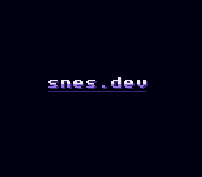
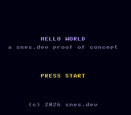
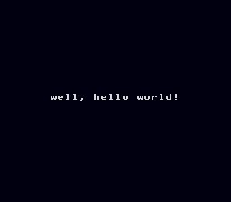

The Super Nintendo hasn't been made for decades, but people never stopped
writing software for it. [SNES Central's homebrew list](https://snescentral.com/homebrew.php)
is long, and the [SNESdev wiki](https://snes.nesdev.org/wiki/SNESdev_Wiki)
documents the hardware better than Nintendo's own manuals ever did.

This blog follows my attempt to make a real SNES game: from an empty folder,
through an emulator and a flash cart, to a cartridge I can plug into a
console. I haven't settled on the game itself yet, so the first job is the
boring, essential part: a toolchain and a ROM that proves it works.

I'm also building this live with an AI coding assistant (Claude Code). It
wrote most of the code in this post while I steered and reviewed, and I'll
be upfront throughout about where it helped and where it tripped.

By the end of this post we have a 32 KiB ROM that shows a studio logo, a
title screen, and a "game":

| Boot logo | Title screen | The "game" |
|---|---|---|
|  |  |  |

## The ground rules

- **Assembly, not C.** The SNES CPU is a 65816, a 16-bit extension of the
  6502, and good SNES code is written close to the hardware. C toolchains
  exist (more on that below), but I've spent years reading ARM and x86
  disassembly, so writing assembly directly is the most direct way for me
  to learn this machine.
- **Emulator first, hardware second.** Everything gets developed and tested
  in an emulator. Milestones get checked on a real console with an
  EverDrive flash cart. Eventually it goes on a real cartridge.
- **Reproducible.** If you want to follow along, you should be able to get
  the same ROM, byte for byte.

## Which OS?

Short answer: any of them. A SNES "cross-compiler" is just an assembler and
a linker that output 65816 code, and those run anywhere. My MacBook builds
this project fine, and so does Linux.

I picked **Ubuntu 24.04 LTS as the reference platform** because it's the
easiest setup to reproduce. Everything comes from `apt` except the
emulator, which is one download. You can run it on bare metal, in a VM (I
use [UTM](https://mac.getutm.app/) on Apple Silicon: pick an **arm64**
Ubuntu image, because x86 guests are emulated and slow), or in Docker.

Here's a nice surprise: the ROM I build on macOS and the ROM built in the
Ubuntu container are **byte-for-byte identical**. The assembler and linker
are fully deterministic, so the host OS doesn't matter.

## Choosing an assembler

The SNESdev wiki's [tools page](https://snes.nesdev.org/wiki/Tools) lists a
lot of options:

| Option | What it is |
|---|---|
| **ca65 / ld65** (cc65 suite) | Macro assembler + linker |
| 64tass, asar, WLA-DX, bass, … | Other assemblers (asar is a favourite for ROM hacking) |
| [PVSnesLib](https://github.com/alekmaul/pvsneslib) | A C SDK with libraries for backgrounds, sprites, input and sound |

PVSnesLib is the obvious choice if you want to write C. It's mature,
MIT-licensed and has prebuilt releases for every OS. I'll be reading its
source for ideas.

For assembly I went with **ca65**, mainly for one reason: it's the only
assembler with full debugging support in [Mesen](https://www.mesen.ca/),
the best SNES development emulator. With ca65's debug symbols loaded, Mesen
shows my source code, labels and variables instead of raw disassembly. It's
also packaged everywhere (`apt install cc65`, `brew install cc65`), and its
linker makes the memory map an explicit config file, which turns out to
matter a lot on the SNES.

## Choosing an emulator

**Mesen 2** is the development emulator: an accurate SNES core, a full
debugger (VRAM, palette and tilemap viewers, breakpoints, an event viewer
showing what happened on which scanline), Lua scripting, and a headless
test-runner mode that comes up again below. Before hardware milestones I'll
also check the ROM in a second accuracy-focused emulator (ares or bsnes).

## Setup

On Ubuntu 24.04:

```sh
./tools/setup-ubuntu.sh
```

It installs `cc65`, `make`, `python3`, SDL2 and the .NET 8 runtime with
`apt` (Mesen's Linux build is a .NET app), then downloads Mesen 2.1.1 into
`~/.local/opt/mesen`.

With Docker on any OS, skip the setup entirely:

```sh
make docker-test   # builds an Ubuntu 24.04 image, then runs `make test` in it
```

Then:

```sh
make        # build/hello.sfc
make run    # play it in Mesen
make test   # run it headless and check every screen
```

## How the project is laid out

```
src/        assembly: header, init, video, input, main
config/     the linker's memory map
assets/     graphics, drawn as text (yes, really, see below)
tools/      a graphics converter and a checksum fixer, in Python
tests/      a Lua script that plays the game in Mesen
```

## The SNES in five minutes (just enough for hello world)

- **CPU:** a 65816 at up to 3.58 MHz. Its accumulator and index registers
  can each be switched between 8 and 16 bits at runtime (more on why that's
  a trap below).
- **Memory:** 128 KiB of work RAM, plus the cartridge ROM mapped into the
  CPU's 16 MiB address space. This ROM uses the "LoROM" layout, where each
  bank's upper 32 KiB ($8000-$FFFF) is ROM.
- **Video (PPU):** a separate chip with its own 64 KiB of VRAM, a 256-color
  palette (CGRAM) and sprite memory (OAM). You don't draw pixels. You load
  8×8 **tiles** into VRAM, arrange them with **tilemaps** (grids of tile
  numbers), and pick colors with **palettes**.
- **The one rule:** the PPU only accepts writes to VRAM, CGRAM and OAM while
  it isn't drawing, which means during **vertical blank** (about 37 of the
  262 scanlines per frame) or with the screen switched off (**forced
  blank**). Every frame, an **NMI** interrupt tells you vblank has started.

## Walking through the ROM

### 1. The header

The console and flash carts identify a ROM from a 48-byte header at the
top of bank 0. In a LoROM file that's offset `$7FB0`, right before the
interrupt vectors:

```asm
.segment "HEADER"       ; $00:FFB0
    .res 16, $00        ; expanded header: unused
    .byte TITLE         ; 21-byte, space-padded title
    .res 21 - .strlen(TITLE), ' '
    .byte $20           ; $FFD5 map mode: LoROM, SlowROM
    .byte $00           ; $FFD6 cartridge type: ROM only
    .byte $05           ; $FFD7 ROM size: 1 << 5 = 32 KiB
    .byte $00           ; $FFD8 RAM size: none
    .byte $01           ; $FFD9 destination: North America
    .byte $00           ; $FFDA developer ID
    .byte $00           ; $FFDB version
    .word $FFFF         ; $FFDC checksum complement \ patched after linking
    .word $0000         ; $FFDE checksum            /
```

The checksum is a 16-bit sum of every byte in the ROM, *including the
header*. ld65 can't compute that, so a short Python script patches it in
after linking. Emulators mostly just warn about a bad checksum, but some
flash carts use it to work out the memory map, so it's worth getting right.

### 2. Reset: assume nothing

At power-on, RAM, VRAM, palettes and most registers hold garbage, and the
CPU starts in 6502 emulation mode. The reset handler follows the SNESdev
wiki's [recommended init sequence](https://snes.nesdev.org/wiki/Init_code):

```asm
.proc reset_handler
    sei                 ; ignore IRQs while we set up
    clc
    xce                 ; carry -> emulation flag: switch to native 65816 mode
    rep #$38            ; 16-bit A and X/Y, decimal mode off
    ldx #STACK_TOP
    txs
    ...
```

Then it clears all 128 KiB of RAM with two DMA transfers that copy a single
zero byte from ROM over and over into the RAM port. There's a trap here:
the stack lives in that RAM, so if the clear runs inside a subroutine, it
erases its own return address. It has to be inline, before the first `jsr`.

After that, every PPU register gets its documented reset value, VRAM and
palettes are cleared (more fixed-source DMA), and all 128 sprites are
parked below the screen.

### 3. Graphics as text

There's no image editor in this project yet. Graphics are drawn as text,
where `.` is transparent and `#`, `=`, `:` are colors 1-3:

```
glyph A
..##....
.####...
##..##..
##..##..
######..
##..##..
##..##..
........
```

A small Python script converts that into the SNES's 2bpp tile format: 16
bytes per tile, two bit planes per row. The font has all printable ASCII
and loads at tile 32, so **the tile number of a character equals its ASCII
code**, and drawing text means writing bytes straight into the tilemap.

The logo started as the font's lowercase letters, doubled in size, with a
two-tone fill, a drop shadow and an underline. A throwaway script generated
it, and the resulting text file is now the source of truth.

Is this how a real game should handle art? No. When there's real art it
will come from PNGs through a converter like
[SuperFamiconv](https://github.com/Optiroc/SuperFamiconv). But text assets
diff nicely in git, need no tools, and an AI assistant can edit them
directly. For a hello world that's a good trade.

### 4. Video setup

The ROM uses **Mode 0**: four background layers, all with 4-color tiles.
BG1 holds the logo and most text. BG2 holds just "PRESS START" (you'll see
why). Both share one set of tiles:

```asm
    stz BGMODE                              ; Mode 0
    lda #(BG1_MAP >> 8) & $FC
    sta BG1SC                               ; BG1 tilemap at VRAM $0000
    lda #(BG2_MAP >> 8) & $FC
    sta BG2SC                               ; BG2 tilemap at VRAM $0400
    lda #((BG_CHR >> 12) << 4) | (BG_CHR >> 12)
    sta BG12NBA                             ; both use the tiles at $1000
```

A fun quirk: the PPU never displays scanline 0. If you leave vertical scroll
at 0, the top row of pixels of your tilemap is hidden. The standard fix is
to set vertical scroll to -1.

### 5. The NMI handler and "shadow registers"

Since the PPU is only safe to touch during vblank, the simplest structure is
to never touch it from the main code at all, except while the screen is off.
The main code writes the values it wants into RAM variables ("shadow
registers"), and the NMI handler copies them to the hardware at the start of
each vblank:

```asm
    lda RDNMI           ; reading RDNMI acknowledges the NMI
    lda inidisp_shadow
    sta INIDISP         ; forced blank + brightness
    lda tm_shadow
    sta TM              ; which layers are visible
    A16
    inc frame_count
```

That gives two effects for free:

- **Fades:** step brightness from 0 to 15 in `inidisp_shadow`, one step every
  two frames.
- **Blinking text:** "PRESS START" sits alone on BG2, so blinking it means
  toggling BG2 in `tm_shadow` every 32 frames. No VRAM writes needed.

Loading a new scene follows one pattern: fade out, switch to forced blank,
write VRAM freely, fade back in.

### 6. Reading the controller

The SNES can read the controllers automatically at the start of each vblank
and leave the results in registers. The code waits for that read to finish,
then works out which buttons went down since the previous frame:

```asm
    A16
    lda pad_held
    eor #$FFFF          ; buttons that were up last time...
    and JOY1L           ; ...and are down now
    sta pad_pressed
```

### 7. The 8-bit/16-bit trap

The 65816's accumulator and index registers are 8 or 16 bits wide depending
on two CPU flags. The *assembler* has to know which, because `lda #$12`
assembles to different byte counts in each mode, but it can't follow the
flags itself. If the two disagree, the CPU reads part of an instruction as
the next opcode and things go strange. So the project uses one convention
(8-bit A, 16-bit X/Y between routines) and macros that change the CPU flag
and the assembler's assumption together:

```asm
.macro A16
    rep #$20
    .a16
.endmacro
```

## Testing without looking

This is the part I'm happiest with. Mesen has a **headless test runner**: it
boots a ROM with no window, runs a Lua script at full speed, and exits with
whatever code the script returns. `tests/smoke.lua` plays the game the way a
person would. It waits for each screen by reading the tilemaps straight out
of VRAM (the ASCII trick means you can literally search VRAM for "PRESS
START"), checks that the PPU is at full brightness, presses Start, and
screenshots each scene:

```
$ make test
ok   frame   36  logo faded in
ok   frame  221  title screen faded in, PRESS START visible
ok   frame  401  title screen still waiting after 3 s without input
ok   frame  466  hello screen faded in
ok   frame  586  hello screen still showing 2 s later
PASS all scenes reached
```

The whole run takes a couple of seconds. The screenshots at the top of this
post came from it. It also means the AI assistant can check its own work
(build, run, look at the screenshots) without me squinting at an emulator
after every change.

Getting there took some digging through Mesen's source, and the findings are
worth writing down:

- With no settings file, Mesen opens its first-run setup wizard, *even in
  headless mode*. On a machine without a display that's a crash. A
  `settings.json` next to the executable switches Mesen to portable mode and
  skips the wizard.
- With a fresh config, **no controller is plugged in**, so the script's
  button presses went nowhere. Pass `--snes.port1.type=SnesController`.
- Lua file access is off by default. Pass
  `--debug.scriptWindow.allowIoOsAccess=true` to save screenshots.
- On macOS, Mesen needs SDL2 from Homebrew, and from a Homebrew of the
  *same CPU architecture* as the Mesen build you downloaded. My Mac has both
  an Intel and an ARM Homebrew (as many migrated Macs do), and the Apple
  Silicon build went looking in the one that didn't have it.

## On real hardware

`build/hello.sfc` is a plain headerless ROM, so it goes straight onto the
EverDrive's SD card.

> **TODO before publishing:** EverDrive model, whether it booted first try,
> and a photo of it running on the console.

## What's next

- Run it on the console (see above).
- Decide what the game actually *is*.
- Sprites, then sound. The SNES's audio chip is a whole separate CPU with
  its own program, which deserves a post of its own.
- A real art pipeline (PNG → tiles).

The full source is on GitHub:
[decidedlygray/snes_dev](https://github.com/decidedlygray/snes_dev).
